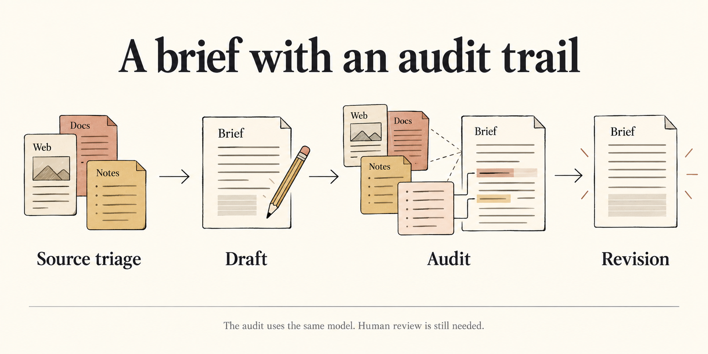

# BriefCheck

> **Website-upload edition:** The runnable code, tests, prompts, selected report and narrated demo are visible here. All other recorded runs and the original complete manifest are preserved inside [complete-release.zip](complete-release.zip). Extract that archive into a separate folder to inspect the full experiment history and follow historical run links. This smaller edition includes only the selected run in its `runs/` directory.


A company brief should be easy to read and possible to question. BriefCheck keeps the draft, the audit and the revision together, with source passages beside the claims they support.

[Read the example](submission/brief.md) · [Open the experiment log](TEST_LOG.md) · [Start here](START_HERE.txt)

> **Current status:** Saved examples and the local UI work without a key. The latest Groq GPT-OSS-20B v4 run is **completed** (`v4-groq-20b-01`). Execution and zero-call replay have passed; wording and completeness still need review. Earlier free OpenRouter runs completed on older revisions but had content issues. This account then exhausted its daily free allowance. No paid OpenRouter calls were used.

## Open the research notebook

Extract the whole folder. With **Python 3.10+** installed, open a terminal in that folder:

```bash
python3 webui.py
```

On Windows, use `py webui.py`. No Python packages need installing. Open **http://127.0.0.1:8766/** and select **v3**.

The example uses eight supplied documents about fictional **SRVCABLE**, with a research cutoff of **23 September 2026**. It is a preserved model-session capture, not a new API run. Read the 450-word brief, inspect its citations, compare the draft with its revision, and export the original Markdown. Review the forecast wording and call-date interpretation yourself before selecting it for submission.

## The editorial process



*AI-generated conceptual illustrations. Sources are supplied locally; the app does not browse or fetch web pages. This diagram describes v4's design; actual execution outcomes are recorded below.*

| Stage | What it does | What the reader can inspect |
|---|---|---|
| Source triage | Separates relevant primary evidence, context and excluded documents | Decisions and original passages |
| Draft | Writes claims and selects passage IDs | Model wording and citations |
| Audit | Compares the draft against original evidence in a separate model request | Claim reviews and repair instructions |
| Revision | Produces the revised brief | Final wording and retained run artifacts |

The audit uses the **same model** as the writer. It is a separate request, not an independent source of truth, and there is no second semantic audit after revision. Code inserts exact source passages rather than asking the model to reproduce quotations.

A useful example is the disagreement between the issuer's revenue figure and the news article's figure. The notebook lets a reviewer inspect both, instead of treating a citation badge as proof.

## Saved experiments and live generation

The original three experiments, their prompts and model-session responses are preserved in [TEST_LOG.md](TEST_LOG.md). Those captured runs are distinct from the experimental v4 API workflow. Original commands remain in [LEGACY_README.md](LEGACY_README.md).

For a fresh run, open **Generate a new report**, select **v4 / Groq**, enter model **`openai/gpt-oss-20b`**, and use your own **Groq API key**. Allow roughly 5–10 minutes. See the actual outcome above and [run results](LIVE_TEST_RESULTS.txt); another run can differ or fail. OpenRouter is a separate service with a separate key, and its free routes are not recommended for a deadline demonstration.

The local server uses the key for the request and does not save it to run artifacts or browser storage. Generation sends the selected documents to the chosen provider. Never publish a `.env` file. [Provider setup](PROVIDER_SETUP.md) explains configuration, budgets and waits; [engine notes](ENGINE_NOTES.md) retain CLI commands and validation details.

## What the checks cannot establish

Valid passage IDs and exact quotations do not establish that a claim follows from the evidence. The model can misread a denominator, strengthen a forecast or omit an important fact. Human review is still needed. This app accepts dated Markdown/text documents; a ticker alone does not download NSE data, and PDFs are unsupported.

The v4 passage engine, provider adapter and UI share code with SourceLens. BriefCheck's distinguishing workflow is draft → audit → revision. Describe that shared work, AI assistance and your own contribution accurately.

## Review and hand over

- [Selected brief](submission/brief.md): exact copy of the original saved output; owner review pending.
- [Narrated demo](submission/demo.mp4) and [transcript](submission/demo-narration.txt): an edited walkthrough of actual app screens, with Kokoro synthetic narration. Review before submission.
- [Recording guide](RECORDING_GUIDE.md): how the walkthrough was made and what it demonstrates.
- [Submission checklist](SUBMISSION_CHECKLIST.md): build link, report, experiments and video.
- [Release checks](RELEASE_CHECKS.txt): test results and preservation checks.

Run the local checks:

```bash
python3 -m unittest discover -s tests -q
python3 -m unittest test_v4 test_webui -q
python3 briefcheck.py validate --run runs/v3
```

These tests and saved-run checks make no model calls. Passing them does not certify factual accuracy or successful live generation. Nothing has been published or submitted on your behalf.
